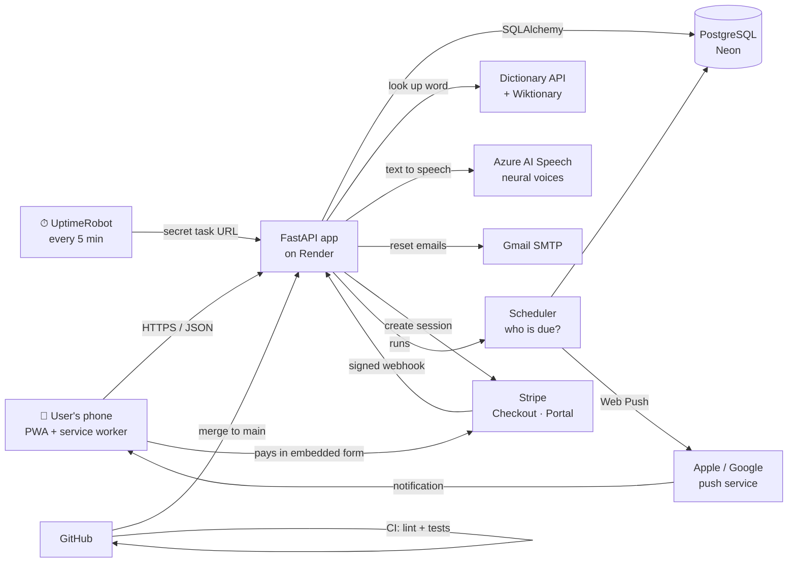
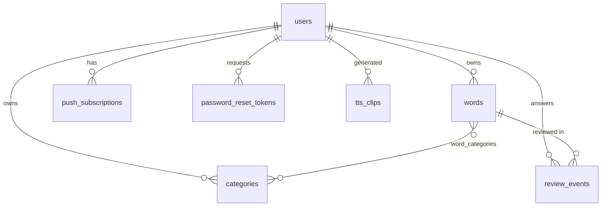

<p align="center">
  
</p>

<h1 align="center">WordPop</h1>

<p align="center">
  <b>Pop anything you want to remember onto your phone – until you know it by heart.</b><br/>
  Words in any language · phrases · sentences · quotes · poems · motivational lines · math formulas · facts
</p>

<p align="center">
  <a href="https://wordpopapp.onrender.com"></a>
</p>

<p align="center">
  <a href="https://github.com/ghorbanianhamed/wordpop/actions/workflows/ci.yml"></a>
  
  
  
  
  
  
  
  
</p>

---

## WordPop today

A **free** app with reminders, a spaced-repetition quiz, voices, CSV import/export and *Share to WordPop* –
plus a **paid WordPop Plus** subscription with a free trial, live payments and self-service subscription
management.

| Free for everyone | WordPop Plus (CA$0.99/month or CA$9.99/year) |
|---|---|
| Save words, phrases, sentences, quotes, poems and formulas in any language | **Natural, human-sounding voices** – Clara and Liam (Canadian), Ava and Andrew (American) |
| Phone notifications on your own schedule, per category | Same voice on every phone and computer |
| Spaced-repetition quiz and progress page | **7-day free trial**, no card needed |
| Listen with the phone's own voice · pronunciation for words | Pay inside the app (Stripe), manage or cancel any time |
| CSV import & export · Share to WordPop · select & delete many | |

## Try it – free, no download from an app store

<table>
<tr>
<td width="62%">

**On iPhone** (Safari)
1. Open **[wordpopapp.onrender.com](https://wordpopapp.onrender.com)** in **Safari**
2. Tap **Share ⬆ → Add to Home Screen → Add**
3. Open **WordPop** from your Home Screen and create an account
4. Go to **Settings → Turn on notifications**

**On Android** (Chrome): open the link and tap **Install**.

**On a computer**: just open the link in any browser.

</td>
<td align="center">

<br/>
<sub>Scan with your phone camera</sub>

</td>
</tr>
</table>

## What can you remember with WordPop?

WordPop isn't only for vocabulary. Save **any short text** – up to 500 characters, with line breaks – and
WordPop shows it to you on your phone at the times you choose, then quizzes you until it sticks.

| Use it for | Example entry | Meaning / note |
|---|---|---|
| 🗣 **Words in any language** | *resilient* · *bonjour* · *你好 (nǐ hǎo)* · *नमस्ते (namaste)* | the meaning in your own language |
| 💬 **Phrases & idioms** | *break the ice* · *¿Qué tal?* · *加油！(jiāyóu)* | when and how to use it |
| ✍️ **Sentences** | *Could you say that again, please?* | a polite way to ask someone to repeat |
| 📜 **Poems & verses** | a few lines of your favourite poem | the poet, or what it means to you |
| 🔥 **Motivation & quotes** | *Small steps every day.* | who said it, or why it matters |
| ➗ **Math & science formulas** | *a² + b² = c²* · *E = mc²* · *sin²x + cos²x = 1* | what each symbol means |
| 💼 **Work vocabulary** | your team's jargon, product names, phrases for meetings | what it means at your company |
| 🧠 **Anything else** | dates, definitions, exam facts, keyboard shortcuts… | a short explanation |

- **Any language and script** – Chinese, Hindi, French, Spanish, Japanese, Arabic… Right-to-left text displays correctly too.
- **Only the text is required** – the meaning/note and example are optional.
- **Categories** keep each kind apart (e.g. *French*, *Chinese*, *Poems*, *Math*), and you choose which ones send reminders.
- **Automatic meanings** for English words and phrases; for everything else you write your own meaning or note.

## Screenshots

| Words | Quiz | Progress | Settings |
|---|---|---|---|
|  |  |  |  |

| Categories | Ready-made categories | iPhone install guide | Sign up |
|---|---|---|---|
|  |  |  |  |

## Features

### Remember
- **Reminders on your phone** – each notification shows only your entry, so you try to recall the meaning; tap it to check
- **Rotating reminders** – every due entry gets its turn; nothing repeats until the others have been shown
- **Your own schedule** – how often, active hours, active days, daily limit, pause for 3 hours / a day / a week, and your own time zone
- **Reminders per category** – switch each category on or off, plus a **No category** switch for entries you haven't filed
- **Spaced-repetition quiz** – entries you forget come back sooner; entries you know are spaced out
- **Progress page** – streak, mastered entries, accuracy, 7-day activity and hardest entries

### Add and organise
- **Any language, any text** – words, phrases, sentences, quotes, poems and formulas up to 500 characters, with line breaks and right-to-left support
- **Auto-filled English entries** – type an English word or phrase, get its meaning, an example, pronunciation and audio
- **Share to WordPop** – select text in any app, tap **Share → WordPop** and it opens ready to save (Android, Chrome/Edge on computers; an iPhone Shortcut does the same). Long-press the app icon for **Add a word**
- **CSV import & export** – back up your entries or add hundreds at once from Excel, Google Sheets or Numbers (UTF-8 and older Excel files, commas, semicolons or tabs; duplicates skipped; missing categories created)
- **Categories** – an entry can belong to several; **10 ready-made categories** (Vocabulary, Phrasal Verbs, Idioms, Casual, Motivation, Math Formulas, Poems, French, Chinese and Hindi basics) start empty, so everyone builds their own list
- **Select & delete many** – tick entries (or *Select all* for the current search or category) and delete them in one go
- **Flashcard view** – opening an entry shows it as an amber flashcard: the entry, a fold line, then the meaning

### Listen and pronounce
- **Listen to every entry and example** – with the phone's own voice in the entry's language (recognised from its script, or from a category such as *French Basics*)
- **Natural voices (WordPop Plus)** – Clara, Liam, Ava and Andrew from **Azure AI Speech**; each recording is made once and stored, so replays are instant and free
- **Pronunciation for single words** – an IPA line for English (CMU Pronouncing Dictionary, offline) and pinyin with tone marks for Chinese

### WordPop Plus (paid)
- **CA$0.99/month or CA$9.99/year** for the natural voices, after a **7-day free trial** that starts with the first listen – no card needed
- **Pay inside the app** – Stripe's payment form opens in a box over Settings (Stripe embedded checkout), with Stripe's own page as a fallback
- **Self-service** – change plan, update the card or cancel in the Stripe Customer Portal; deleting the account cancels the subscription
- **Always in sync** – a signed Stripe webhook keeps each account's Plus status up to date; the ▶ samples stay free for everyone

### App, accounts and privacy
- **Installable app (PWA)** – Home Screen icon, opens instantly from cache, updates itself on the next open, step-by-step iPhone install guide
- **Accounts & security** – bcrypt-hashed passwords, HTTP-only session cookies, **forgot-password emails** with one-time links (stored hashed, rate-limited), reset signs out other devices
- **Privacy** – delete your account and all data in one tap; [Privacy](https://wordpopapp.onrender.com/privacy.html) and [Terms](https://wordpopapp.onrender.com/terms.html) pages
- **Admin analytics** – sign-ups, weekly active users and day-1/7/28 retention

## Tech stack

| Area | Technology | Why |
|---|---|---|
| Backend | **Python 3.12, FastAPI**, SQLAlchemy 2, Pydantic | Fast, typed REST API with automatic docs at `/docs` |
| Database | **PostgreSQL on [Neon](https://neon.com)** (serverless, free tier); SQLite locally and in tests | Real relational database; new columns are added automatically on start-up |
| Frontend | **Progressive Web App** – vanilla JavaScript, service worker, Web App Manifest | Installs on iPhone/Android without an app store; no build step |
| Notifications | **Web Push** with VAPID keys (`pywebpush`) | Native-looking reminders on iPhone (iOS 16.4+), Android and desktop |
| Natural voices | **[Azure AI Speech](https://azure.microsoft.com/products/ai-services/ai-speech)** neural text-to-speech (free F0 tier) | Human-sounding Canadian and American voices; clips cached in PostgreSQL |
| Phone voices | **Web Speech API** (`speechSynthesis`) | Free, offline read-aloud in the entry's language |
| Pronunciation | **eng_to_ipa** (CMU Pronouncing Dictionary), **pypinyin** | Offline IPA for English words, pinyin for Chinese |
| Payments | **[Stripe](https://stripe.com)** – Billing subscriptions, embedded Checkout, Customer Portal, signed webhooks | Card details never reach WordPop; customers manage their own subscription |
| Sharing & files | **Web Share Target API**, CSV (UTF-8 with BOM) | Save text from other apps; spreadsheets in and out |
| Hosting | **[Render](https://render.com)** (Docker web service) | Deploys automatically on every merge to `main` |
| Scheduling & uptime | **[UptimeRobot](https://uptimerobot.com)** calls a secret task URL every 5 minutes | Sends due reminders on time and keeps the free server awake |
| Email | **SMTP** (Gmail App Password) | Password-reset emails |
| English look-up | **Free Dictionary API** + **Wiktionary** fallback | Auto-fills definitions, examples, phonetics and audio for English words and idioms |
| Quality | **pytest** (77 tests), **ruff**, **GitHub Actions CI**, Playwright checks in a real browser | Every pull request is linted and tested automatically |
| Packaging | **Docker**, docker compose | Same container locally and in production |

## Architecture



**How a reminder is chosen.** Every 5 minutes UptimeRobot calls `/api/tasks/send-notifications?key=…`.
For each user with notifications on, the scheduler checks: paused? one of their active days and hours
*in their own time zone*? enough time since the last reminder, and under the daily limit? If so it picks
the next entry – due entries first, then the one shown longest ago – from a category with reminders on,
and sends it to all of the user's devices. Expired push subscriptions are cleaned up automatically, and
one failing device never stops the run for everyone else.

**How WordPop Plus works.** The first natural-voice listen starts a 7-day trial. Buying opens Stripe's
embedded Checkout inside the app; when payment completes, Stripe sends a signed webhook and the account's
Plus status, plan and renewal date are updated. Changes and cancellations in the Customer Portal arrive the
same way. Without Stripe settings, the voices are simply free.

### Database



`users` also holds the reminder schedule, the chosen voice and the WordPop Plus status
(Stripe customer, plan, renewal date, trial start). `tts_clips` stores each generated recording once
(keyed by voice + text).

## Run it locally

You need Python 3.12+.

```bash
git clone https://github.com/ghorbanianhamed/wordpop.git
cd wordpop
cp .env.example .env                    # then edit the values
python scripts/generate_vapid_keys.py   # paste the two lines into .env
cd backend
pip install -r requirements-dev.txt
uvicorn app.main:app --reload           # open http://localhost:8000
```

Leave `DATABASE_URL` empty to use a local SQLite file. Without SMTP settings, password-reset links are
printed in the terminal instead of emailed. Without Azure or Stripe settings, the app uses the phone's
voices and the natural voices stay off.

**With Docker** (includes a PostgreSQL container):

```bash
docker compose up --build
```

**Tests and lint:**

```bash
cd backend
pytest -q
ruff check .
```

## Deploy (free tiers)

1. **Database** – create a project on [Neon](https://neon.com) and copy its connection string.
2. **Web app** – create a Docker **Web Service** on [Render](https://render.com) from this repository and add
   the variables from `.env.example` (use your real `https://` address as `APP_URL`, a long random
   `SECRET_KEY` and a random `CRON_SECRET`).
3. **Reminders** – create an HTTP(s) monitor on [UptimeRobot](https://uptimerobot.com) for
   `https://YOUR-APP.onrender.com/api/tasks/send-notifications?key=YOUR_CRON_SECRET` with a 5-minute interval.
4. **Email** (optional) – add a Gmail App Password as `SMTP_PASSWORD` to enable "Forgot password?" emails.
5. **Natural voices** (optional) – create a free (F0) **Speech service** in the [Azure portal](https://portal.azure.com)
   and add its key and region as `AZURE_SPEECH_KEY` and `AZURE_SPEECH_REGION`. Without them the app uses the phone's voices.
6. **WordPop Plus** (optional) – to charge for the natural voices, create a [Stripe](https://stripe.com) product with
   monthly and yearly prices, a webhook to `/api/billing/webhook` (events `checkout.session.completed` and
   `customer.subscription.created/updated/deleted`), turn on the Customer Portal, and add `STRIPE_SECRET_KEY`,
   `STRIPE_WEBHOOK_SECRET`, `STRIPE_PRICE_MONTHLY` and `STRIPE_PRICE_YEARLY`. Without them the voices are free.
   Add `STRIPE_PUBLISHABLE_KEY` too and the payment form opens in a box inside the app (embedded checkout).
   A restricted key with *Full access – except sensitive operations* is enough.

> The *Send notifications* GitHub Actions workflow is an optional backup scheduler; it is disabled when
> UptimeRobot is used, so reminders are never sent twice.

### Environment variables

| Variable | Needed for |
|---|---|
| `DATABASE_URL`, `SECRET_KEY`, `APP_URL` | the app itself (database, sessions, links in emails and payments) |
| `VAPID_PUBLIC_KEY`, `VAPID_PRIVATE_KEY`, `VAPID_SUBJECT` | push notifications |
| `CRON_SECRET` | the reminder task URL called by UptimeRobot |
| `SMTP_HOST`, `SMTP_PORT`, `SMTP_USER`, `SMTP_PASSWORD`, `MAIL_FROM` | password-reset emails |
| `ADMIN_EMAILS` | the admin statistics page (admins also get WordPop Plus) |
| `AZURE_SPEECH_KEY`, `AZURE_SPEECH_REGION` | natural voices |
| `STRIPE_SECRET_KEY`, `STRIPE_WEBHOOK_SECRET`, `STRIPE_PRICE_MONTHLY`, `STRIPE_PRICE_YEARLY`, `STRIPE_PUBLISHABLE_KEY` | WordPop Plus payments |
| `PLUS_PRICE_MONTHLY_LABEL`, `PLUS_PRICE_YEARLY_LABEL`, `PLUS_TRIAL_DAYS`, `TTS_DAILY_LIMIT` | optional tuning (prices shown in the app, trial length, voice clips per user per day) |

## API

Interactive documentation: **[wordpopapp.onrender.com/docs](https://wordpopapp.onrender.com/docs)**

| Area | Endpoints |
|---|---|
| Auth | `POST /api/auth/signup` · `login` · `logout` · `forgot-password` · `reset-password` · `GET/DELETE /api/auth/me` |
| Words | `GET/POST /api/words` · `PATCH/DELETE /api/words/{id}` · `POST /api/words/delete-many` · `GET /api/dictionary/{word}` |
| Import & export | `GET /api/words/export` (CSV) · `POST /api/words/import` |
| Categories | `GET/POST /api/categories` · `PATCH/DELETE /api/categories/{id}` |
| Quiz | `GET /api/quiz/next` · `POST /api/quiz/answer` |
| Settings & progress | `GET/PUT /api/me/settings` · `POST /api/me/pause` · `GET /api/me/progress` |
| Voices | `GET /api/tts/voices` · `GET /api/tts?text=…&voice=ca-female` (MP3, cached) |
| WordPop Plus | `GET /api/billing/status` · `POST /api/billing/checkout` · `POST /api/billing/portal` · `POST /api/billing/webhook` (Stripe) |
| Push | `GET /api/push/public-key` · `POST /api/push/subscribe` · `unsubscribe` · `test` |
| Ready-made categories | `GET /api/starter-lists` · `POST /api/starter-lists/{key}/import` |
| Tasks | `GET /api/tasks/send-notifications?key=…` (called by UptimeRobot) |
| Admin | `GET /api/admin/stats` |

## Project structure

```
wordpop/
├── backend/
│   ├── app/
│   │   ├── main.py            # FastAPI app: serves the API and the PWA
│   │   ├── config.py          # settings from environment variables / .env
│   │   ├── db.py              # database engine; adds new columns on start-up
│   │   ├── models.py          # database tables
│   │   ├── routers/           # API endpoints by area (auth, words, quiz, billing, tts, transfer, …)
│   │   ├── scheduler.py       # decides who gets a reminder and sends it
│   │   ├── notifications.py   # schedule rules + Web Push delivery
│   │   ├── services.py        # which entry to quiz or send next
│   │   ├── srs.py             # spaced repetition (Leitner boxes)
│   │   ├── dictionary.py      # Dictionary API + Wiktionary look-ups
│   │   ├── pronunciation.py   # language detection, offline IPA and pinyin
│   │   ├── tts.py             # Azure AI Speech natural voices, cached clips
│   │   ├── billing.py         # WordPop Plus: trial, Stripe subscriptions
│   │   ├── csv_io.py          # CSV import and export
│   │   ├── mailer.py          # password-reset emails
│   │   └── data/starter_lists.json   # the ready-made categories
│   └── tests/                 # 77 pytest tests (Stripe and Azure are faked)
├── frontend/                  # the PWA: index.html, app.js, sw.js, styles.css, icons, privacy & terms pages
├── scripts/                   # VAPID keys, icons, QR code, GitHub issues
├── docs/                      # screenshots, QR code, roadmap
├── .github/workflows/         # CI (lint + tests) and backup scheduler
├── Dockerfile
└── docker-compose.yml
```

## Roadmap

- [x] v1 – personal script: SQLite + ntfy notifications
- [x] v2 – multi-user PWA: accounts, categories, schedules, quiz, progress, web push
- [x] Forgot password by email
- [x] Amber design, reliable 5-minute reminders, instant start
- [x] Any language and any short text (sentences, quotes, poems, formulas)
- [x] Listen to every entry · pronunciation for words · flashcard view
- [x] Natural voices (Azure AI Speech)
- [x] **WordPop Plus** – Stripe subscriptions, free trial, in-app payment, Customer Portal
- [x] Import / export as CSV · Share to WordPop · select & delete many
- [ ] Invite testers and track retention
- [ ] Google Play (Trusted Web Activity), then the Apple App Store
- [ ] AI auto-fill (meaning, example, translation) for any language
- [ ] "Say it" pronunciation practice
- [ ] Sign in with Google / magic-link email
- [ ] Nicely typeset math formulas (LaTeX)
- [ ] Database migrations with Alembic

See [docs/ROADMAP.md](docs/ROADMAP.md) for details.

## Privacy

WordPop stores only what it needs: email, hashed password, your entries and settings, quiz answers,
push addresses and – for subscribers – their WordPop Plus status. Card details are handled by Stripe and
never reach WordPop; with the natural voices, only the text being read is sent to Azure AI Speech.
No ads, no selling of data. See the [privacy page](https://wordpopapp.onrender.com/privacy.html) and
the [terms](https://wordpopapp.onrender.com/terms.html).

## License

[MIT](LICENSE) © 2026 Hamed Ghorbanian
